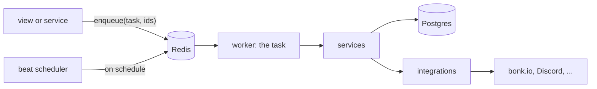

# Background work

Anything that shouldn't make a visitor wait, or that runs on a schedule, runs
on the **Celery worker**: a separate Railway service (`worker`) built from this
repo, taking jobs from Redis. This page is the standard for writing, queueing,
logging, testing and running those jobs. `tests/test_background.py` checks the
rules marked **(tested)**. Why Celery and not threads: [ADR 0010](../adr/0010-background-work-on-celery.md).



## What runs there today

| Task | When | Notes |
|---|---|---|
| `skins.tasks.sync_friends` | Queued by every login (`accounts/sign_in.py` → `players.services.queue_friend_sync`) | The player's bonk.io friend list (`friends.php`). Takes the account-link id; reads the token from the link. Retries twice when bonk.io is unreachable, never on a refusal. Logs `friends_synced`, which the profile toast polls for. Code in `players/tasks.py` since Phase 5.4; it keeps its original registered name (logger `players.tasks`). |
| `skins.tasks.refresh_discord_servers` | Hourly (`CELERY_BEAT_SCHEDULE`) | Member/online counts for the Discord directory. At most once per hour (see "Running twice"). Code in `communities/tasks.py` since Phase 5.2; it keeps its original registered name, so its logs come from logger `communities.tasks` but carry the task name `skins.tasks.refresh_discord_servers`. |
| `players.tasks.sync_replays` | Every `REPLAY_SYNC_INTERVAL_SECONDS` (1 hour) | Names in, DBIDs out with the replay archive (`players/replay_sync.py`). Carries on from saved cursors; skipped while another run holds its lock, or when `BONKVERSE_SYNC_TOKEN` isn't set. |

Flash friends still sync inside the login request: they come in bonk.io's
login reply, so there is nothing to wait for.

## Is it a job for the worker?

Yes, when any of these is true:

- It calls another service and the visitor doesn't need the answer to see the
  next page (friend sync after login).
- It runs on a schedule (the Discord refresh, future stat aggregation).
- It touches many rows and could outlast a 30 s web request.

No, when the visitor needs the result in the response (logging in, wearing a
skin, voting). Those stay in the view, however slow the other service is.

## Writing a task

The friend sync task (`players/tasks.py`), without its retry:

```python
from celery import shared_task


@shared_task(bind=True, soft_time_limit=60, time_limit=90, max_retries=2)
def sync_friends(self, account_link_id: int) -> dict:
    """Store the bonk.io friend list of the player on this account link."""
    link = (
        BonkAccountLink.objects.select_related("user", "bonk_player")
        .filter(id=account_link_id, active=True)
        .first()
    )
    if link is None:
        logger.info("friends sync skipped: account link %s is gone or inactive", account_link_id)
        return {"skipped": "link_gone"}
    outcome = sync_friends_for_link(link)  # the service: players/friends_sync.py
    if outcome.error:
        return {"error": outcome.error}
    logger.info("friends sync done for bonk_id=%s: %s", link.bonk_player.bonk_id, outcome.stats)
    return outcome.stats
```

1. **It lives in an app's `tasks.py` (tested).** Celery finds tasks there, and
   the RFC's file rules apply: a task is a thin entry point that loads what it
   needs and calls a service. The rules themselves live in the service, so
   they can be tested and reused without Celery.
2. **It sets its own `soft_time_limit` and `time_limit` (tested).** At the soft
   limit Celery raises `SoftTimeLimitExceeded` inside the task; catch it where
   a partial run can stop cleanly, log what was done, and return. The hard
   limit kills the process. A scheduled task's hard limit must be shorter than
   its interval **(tested)**, so two copies never overlap.
3. **Its arguments are ids and plain JSON values.** Never a model instance
   (it would be stale by the time the task runs), never a secret: the bonk.io
   token stays in the database, and the task reads it by account-link id.
   Anything queued sits in Redis, readable by anything that can read Redis.
4. **It may find the row gone.** Between queueing and running, a skin can be
   deleted or a link deactivated. Check, log one line, return.
5. **It returns a small dict of counts** (or nothing). Results aren't stored
   **(tested)**, but Celery logs the return value with the task's
   "succeeded" line, which makes it the run's summary.
6. **It never writes to `MEDIA_ROOT`.** The media volume is mounted on the web
   service only; the worker's disk is empty and thrown away on every deploy.
   Work that produces skin files stays in the web service until media moves to
   object storage.

## Running twice

A task is acknowledged only after it finishes (`CELERY_TASK_ACKS_LATE`). If a
deploy or crash cuts it off, Redis hands it out again, so the default is
**at-least-once**. Write every task so a second run is harmless:

- Upsert instead of insert (`update_or_create`, `bulk_create(ignore_conflicts=True)`).
- Compute the final state from the source (the friend list bonk.io returns
  now), not from the previous run.

When a repeat would do damage, opt out with `@shared_task(acks_late=False)`:
the task runs **at most once**, and a cut-off run is simply lost until the next
schedule. `refresh_discord_servers` does this because a repeat would write a
second snapshot for servers it already refreshed **(tested)**.

Redis re-sends an unacknowledged task after `visibility_timeout` (1 hour), so
an at-least-once task's `time_limit` must be shorter **(tested)**.

## Retries

No automatic retries by default. A task that calls another service retries
only a failure that's likely to pass (bonk.io `unavailable`, a timeout), only a
few times, with backoff, and never one that's been refused (`ratelimited`,
`token_rejected`):

```python
@shared_task(bind=True, soft_time_limit=60, time_limit=90, max_retries=2)
def sync_friends(self, account_link_id: int) -> dict:
    ...
    if result.error == BonkError.UNAVAILABLE:
        raise self.retry(countdown=10 * (self.request.retries + 1))
```

The bonk.io client's 120 s cooldown after `ratelimited` applies inside the
worker too ([ADR 0008](../adr/0008-bonk-refusals.md)); a task that gets
`ratelimited` stops and logs it.

## Queueing work

```python
from core.background import enqueue
from players.tasks import sync_friends

enqueue(sync_friends, link.id)
```

- **Always through `core.background.enqueue` (tested).** It never raises: if
  Redis is down it retries twice within about a second, logs
  `could not queue task <name>` with the reason, and returns `False`. The
  caller decides what that means (for login: no friend toast this time); a
  queueing failure never breaks the page. `.delay()` and `.apply_async()` are
  not used anywhere else.
- **No threads (tested).** `threading.Thread` dies with its gunicorn worker on
  every deploy and every `max_requests` recycle, silently. The last two (the
  friend sync after login and the page-view-started replay sync) moved to the
  worker in RFC-0001 4.3.
- Queue after the database write the task depends on is committed. Requests
  run in autocommit (no `ATOMIC_REQUESTS`, pinned by a test), so a row saved
  earlier in the view is already committed; login queues the friend sync
  right after saving the link. Inside a `transaction.atomic()` block, use
  `transaction.on_commit(lambda: enqueue(task, obj.id))`, or
  the worker can run before the row exists.

## Schedules

Schedules are code, in `CELERY_BEAT_SCHEDULE` in `settings.py`:

```python
CELERY_BEAT_SCHEDULE = {
    "refresh-discord-servers": {
        "task": "skins.tasks.refresh_discord_servers",
        "schedule": 60 * 60,  # seconds, or celery.schedules.crontab(...)
    },
}
```

The worker runs the scheduler too (`--beat`), with django-celery-beat's
`DatabaseScheduler`, which copies these entries into its `PeriodicTask` table
at startup and records `last_run_at` there (the Discord page shows "next
refresh" from it; `/admin` shows every schedule's last run). **Change a
schedule in code, not in /admin**; an /admin edit is overwritten on the next
deploy. Every entry must name a real task **(tested)**.

**A new schedule runs as soon as the worker starts** (`core.beat.Scheduler`,
**tested**), then every interval after. Without that, django-celery-beat
counts a never-run schedule's first interval from the moment the worker
last started, so each deploy pushed it back again; on 2026-11-10 four
deploys within an hour kept the new hourly jobs from running at all. If the
worker restarts before a first run has been saved (beat saves every few
minutes), that first run happens once more, so a scheduled task must be
safe to run twice or opt out with `acks_late=False` and check for itself.

Because the scheduler lives in the worker, **there must be exactly one worker
replica.** Two would send every scheduled job twice. To scale out later, run
`celery beat` as its own one-replica service and drop `--beat` from the
worker.

## Logging

- `logger = logging.getLogger(__name__)`, as everywhere else. Never `print`.
- **Every line written inside a task is tagged** with the task name and the
  first 8 characters of its id, by `core.background.TaskContextFilter` on the
  console handler. A bonk.io error logged by `integrations/bonk_api.py` during
  a friend sync reads:

  ```json
  {"message": "WARNING integrations.bonk_api [skins.tasks.sync_friends 0d4fcc8a]: bonk get_friends failed: unavailable",
   "level": "warn", "logger": "integrations.bonk_api",
   "task": "skins.tasks.sync_friends", "task_id": "0d4fcc8a-9750-4039-8153-eb9f21373c76"}
  ```

  (one line in the real logs; `core/logs.py` writes JSON so Railway shows each
  line's real level). In Railway, `@task_id:<id>` shows one run from start to
  finish, and `@task:skins.tasks.sync_friends` every run of one task.
- Celery logs each run's lifecycle itself (logger `celery`, INFO):
  `Task ...[id] received`, `succeeded in 0.42s: {counts}`, and on an exception
  `raised unexpected` with the traceback. Don't add your own start/finish
  lines; do log one summary line with counts when the task does real work.
- Never log tokens, passwords, `REDIS_URL` or anything a task got from the
  bonk.io session.

## Testing

- **Test the service, not Celery.** Most tests call the service function
  directly. A task can also be called like a function
  (`refresh_discord_servers()`), which runs it inline.
- **Queued work runs inline in tests.** `tests/conftest.py` turns on eager mode
  for every test, so a view test that triggers `enqueue` runs the task inside
  the test, errors included. Tests never need Redis or a worker.
- For "the view queues the task", assert on the task's effect, or patch
  `enqueue` in the view's module and assert on the call.
- Time-limit handling: raise `SoftTimeLimitExceeded` from a patched dependency
  and check the task stops cleanly (see `tests/test_discord.py`).

## Running it locally

With Redis running (`docker compose up -d`) and `REDIS_URL` set:

```bash
celery -A bonk_skin_search worker --beat --loglevel INFO
```

Or skip the worker: `CELERY_TASK_ALWAYS_EAGER=1` in `.env` runs queued tasks
inline in the web process (scheduled tasks then don't run; call them from
`manage.py shell`). Never set it in production.

## Production

| | Web (`bonkverse`) | Worker (`worker`) |
|---|---|---|
| Config file | `railway.json` | `railway.worker.json` (set as the service's config file path) |
| Image | Dockerfile | the same Dockerfile **(tested)** |
| Starts | `migrate`, then gunicorn | `celery -A bonk_skin_search worker --beat` (no migrate) |
| Healthcheck | `/` | none: it serves no pages **(tested)** |
| Replicas | 1 (media volume) | **exactly 1** (it runs the scheduler) |
| Variables | all | `SECRET_KEY`, `DATABASE_URL`, `REDIS_URL`, `ENV`, plus whatever its tasks' integrations need, as references to `bonkverse`'s values |

Both deploy from `main` on every merge. Migrations run only in the web
service, so a task that needs a new column can fail for the minute between the
worker starting and the web service migrating; such a task should ship in the
PR after the migration.

Concurrency is `CELERY_CONCURRENCY` (default 2 processes); each process holds
one Postgres connection while it works.

When jobs stop running: [runbook](../operations/runbook.md#background-jobs-arent-running).

## Adding a task: checklist

1. Service function first, with tests; the task only loads and calls it.
2. `@shared_task(soft_time_limit=..., time_limit=...)` in the app's `tasks.py`;
   `acks_late=False` if a repeat would do damage.
3. Id-only arguments; handle "row gone"; return counts.
4. Queue it with `enqueue` (after commit), or add it to `CELERY_BEAT_SCHEDULE`.
5. New variables it needs: add them to the worker service too
   ([configuration.md](../operations/configuration.md)).
6. Add it to "What runs there today" above.
