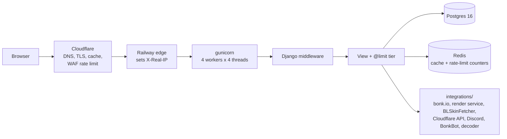

# Request flow

What happens to a request to `bonkverse.io`, in order. Each hop names the file
or dashboard that owns it.

1. **Cloudflare** (dashboard, zone `bonkverse.io`) terminates TLS, serves cached
   files, and applies the WAF rate-limiting rule on `/search` (50 requests / 10 s
   per IP → error 1015). Requests it blocks never reach Railway.
2. **Railway's edge** forwards to the `bonkverse` service and sets `X-Real-IP`
   to the connecting address (a Cloudflare IP).
3. **gunicorn** (`gunicorn.conf.py`) runs 4 worker processes × 4 threads, so up
   to 16 requests run at once. A request over 30 s is killed. See
   [ADR 0001](../adr/0001-gunicorn-threaded-workers.md).
4. **Middleware** (`settings.MIDDLEWARE`): WhiteNoise serves `/static/`;
   sessions, CSRF and auth run; `RatelimitMiddleware` turns any leftover
   `Ratelimited` exception into the 429 page.
5. **The view** runs. Almost every view is wrapped in `@limit("<tier>")`
   (`core/ratelimits.py`), which counts the request in Redis against the
   visitor's real IP (`core/client_ip.py`: `CF-Connecting-IP`, trusted only when
   the request came from a Cloudflare address). Over the limit → 429 with a
   countdown. See [rate-limiting.md](../operations/rate-limiting.md).
6. **Data**: Postgres for everything persistent; Redis for the cache and
   rate-limit counters only. If Redis is unreachable the site keeps working
   without either (fail open).
7. **Other services**, each configured in settings
   ([configuration.md](../operations/configuration.md)): bonk.io (login, friends,
   wearing skins; all through `integrations/bonk_api.py`), the render service (staff re-render), BonkBot (matchmaking),
   the BonkLeagues fetcher (upload), the map decoder.

## Errors

- An unhandled exception renders `skins/templates/500.html` (standalone: no
  database, static files or base template) and is logged by `django.request`
  with its traceback to stdout, which Railway collects. Sentry also captures it.
- `404.html` and `429.html` extend the site layout via `error_base.html`.

## Files

`/media/` (skin PNG/SVG/thumbnails) is served by Django from the Railway volume
mounted at `/app/media`, through `skins/media.py` (rate-limited, cache headers).
`/static/` is collected at build time and served by WhiteNoise.
