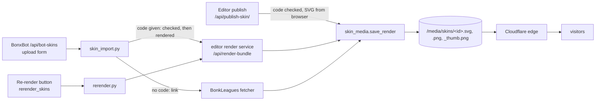

# Skin images

How a skin gets its images, where they live, and how to redo them. Why it
works this way: [ADR 0015](../adr/0015-skin-images-from-skin-codes.md). The
skin code format and what a code must pass: [bonk/skin-codes.md](../bonk/skin-codes.md).

## Where images live

Every skin has three files on the `bonkverse` service's volume, served from
`/media/` (`skins/media.py`: rate limit, browser cache 1 hour, Cloudflare
edge 1 week):

| File | Size | Notes |
|---|---|---|
| `skins/<id>.svg` | vector | `Skin.image_url` points here; cards and pages show it |
| `skins/<id>.png` | 512 × 512 | `SkinImage` kind `png` |
| `skins/<id>_thumb.png` | 128 × 128 | `SkinImage` kind `thumbnail` |

`skin_media.save_render(skin, bundle)` is the only code that writes them. It
writes temporary files, moves them into place, then sets `image_url` and one
`SkinImage` row per kind. If any write fails, the old files and rows are left
as they were. The worker can't write them (no volume there).

## Where images come from

| Path | Code | Images |
|---|---|---|
| Editor publish (`skins/apis/publish_skin.py`) | Checked with `SkinCode.parse()` (422 if not a skin) | The SVG the editor sends, checked by `svg_sanitizer.py`; PNGs drawn locally with cairosvg |
| BonxBot (`/api/bot-skins`) or upload form, with a code (`skins/skin_import.py`) | Checked (`invalid_skin_code`, not retried) | Rendered by the editor's render service |
| BonxBot or upload form, BonkLeagues link only | Taken from BonkLeagues | Fetched from BonkLeagues (its renderer) |
| Re-render (`skins/rerender.py`) | The stored code | Rendered by the editor's render service, then Cloudflare's copies purged |

The render service is `POST {BONKVERSE_RENDER_URL}/api/render-bundle`
(`integrations/editor_render.py`), part of the `skin-editor` repo. It decodes
the code with the same rules as `core/bonk/skin_codes.py` and draws each
layer from `public/output_shapes/<shape>.svg`.

**It draws a skin without any layer whose shape it doesn't have, and still
answers `ok`.** A shape missing from the editor means images saved without
that layer. The shapes it has are `1 … TOTAL_BONK_SHAPES` (115, including the
whisp); `core.bonk.skin_codes.MAX_SHAPE_ID` must match.

## Redoing images

- **One skin:** the staff Re-render button on the search page.
- **Many skins:** `manage.py rerender_skins` on `bonkverse`: dry run first,
  then `--run`; see the [runbook](../operations/runbook.md#skin-images-are-broken-re-render-them).
- **Check stored codes:** `manage.py audit_skin_codes` lists codes the rules
  refuse (read-only). Those skins can't be re-rendered and keep their images.

Before a bulk re-render, check that the editor has every shape the gallery
uses: a skin using a shape the editor lacks loses that layer
([incident](../incidents/2026-11-10-rerender-dropped-layers.md)).

## Changing the format or the shapes

- **A new shape:** add its SVG and center to the editor, raise
  `TOTAL_BONK_SHAPES` (skin-editor `src/bonk/constants.js`) and
  `MAX_SHAPE_ID` (`core/bonk/skin_codes.py`) together, deploy the editor,
  then re-render the skins that use it.
- **A new form of skin code:** change both decoders (Python
  `core/bonk/skin_codes.py`, editor `src/bonk/decode/decodeSkinCore.js`) in
  matching PRs, each with a test built on the real code, then run
  `audit_skin_codes`.
